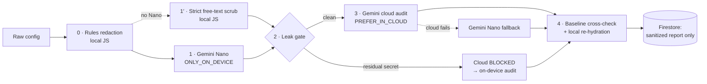

<div align="center">

# 🛡️ ConfigShield

### Hybrid-AI network config auditor: your secrets never leave the laptop

**Gemini Nano redacts on-device · Gemini audits in the cloud · local rules verify every finding**

[](https://github.com/natrajexplore/ConfigShield/actions/workflows/ci.yml)
[](LICENSE)


Built for **#BuildHybridAI 2026** · Category: **Web (Chrome)**

[Why](#-the-problem) · [How it works](#-how-it-works) · [Features](#-features) · [Quick start](#-quick-start) · [Security model](#-security--privacy-model) · [Testing](#-testing) · [Troubleshooting](#-troubleshooting)

</div>

---

## 🎯 The problem

A router or firewall config is one of the most sensitive files a company has. A single `show running-config` holds enable secrets, SNMP communities, VPN pre-shared keys, TACACS+ keys, public IP plans, and, hidden in interface descriptions, **customer names, employees and carrier circuit IDs**.

AI could review these configs ten times faster than a person. But most security policies (rightly) forbid pasting them into a cloud chatbot, so engineers either:

- skip the review, or
- spend an hour sanitising by hand, and still miss `description Desk of Priya Raman – Treasury`.

## 💡 The solution

**ConfigShield makes the hybrid split the privacy boundary.** A small model *on the device* does the part that needs privacy. A large model *in the cloud* does the part that needs depth. Deterministic rules guard the hand-off in both directions.

```text
┌──────────────────────── YOUR LAPTOP ────────────────────────┐   ┊   ┌──────── CLOUD ────────┐
│ raw config → rules → Gemini Nano → leak gate → vault         │   ┊   │ Gemini deep audit     │
│   (secrets, IPs, names, circuit IDs replaced with tokens)    │ ──┊─▶ │ sees <SECRET_1>,      │
│ ← re-hydrate real values locally ← rule cross-check ←────────│ ◀─┊── │ <IP_PUB_2>, <PERSON_1>│
└──────────────────────────────────────────────────────────────┘   ┊   └───────────────────────┘
                                                            privacy boundary
```

The cloud model gets `snmp-server community <WEAKSECRET_1> RO`, never `public`. It can still tell you that the community is a vendor default, because a local check flagged it as weak before the value was replaced.

---

## ⚙️ How it works



| # | Stage | Runs on | Firebase AI Logic mode | Why |
|---|---|---|---|---|
| 0 | Rule-based redaction | Browser JS | — | 29 keyword-anchored rules plus hash, PEM/cert, e-mail, phone and IPv4/IPv6 detectors. Known secret formats are always removed, even with no AI |
| 1 | Contextual redaction | **Gemini Nano** | `ONLY_ON_DEVICE` | Only a language model can tell that *"Tata Comm circuit 045CHEN88812"* identifies a carrier and a circuit. Cloud fallback is **deliberately disabled**: raw text must never leave the device |
| 1′ | Strict free-text scrub | Browser JS | — | When Nano can't run, every non-generic description and comment is masked as `<DESC_n>` |
| 2 | Leak gate | Browser JS | — | Re-runs every rule and checks every vault value. **Fails closed**: any hit blocks the cloud call |
| 3 | Deep audit | **Gemini (cloud)** → Nano fallback | `PREFER_IN_CLOUD` | A larger model gives a better audit. Offline or on a plane, it still works on-device |
| 3′ | Air-gapped audit | **Gemini Nano** | `ONLY_ON_DEVICE` | Classified or regulated sites: nothing leaves the machine, and prompts are chunked to fit Nano's 9,216-token window |
| 3″ | Rules-only fallback | Browser JS | — | If every AI path fails, 32 baseline checks still produce a report |
| 4 | Cross-check + re-hydration | Browser memory | — | Rules confirm or add findings, cited evidence is verified, and real values come back **locally only** |

Every stage shows a live badge (`LOCAL · rules` / `ON-DEVICE · Gemini Nano` / `CLOUD · Gemini`) read from `response.inferenceSource`. A **privacy receipt** then states exactly what crossed the boundary: *"Sent 1,209 chars of sanitized text (24 values masked first)"* or *"Nothing left this device."*

### Where Firebase AI Logic is called at runtime

| File | What it does |
|---|---|
| [`src/firebase.ts`](src/firebase.ts) | `getAI(app, { backend: new GoogleAIBackend() })`, App Check, Anonymous Auth, Firestore, Remote Config (with a 5 s fetch timeout so offline use never stalls) |
| [`src/ai/models.ts`](src/ai/models.ts) | Three `getGenerativeModel` configurations (`ONLY_ON_DEVICE` redactor, `PREFER_IN_CLOUD` auditor, `ONLY_ON_DEVICE` air-gapped auditor), with the **same JSON schema** on both paths (`responseConstraint` on-device, `responseJsonSchema` in the cloud). Instances are cached so the Nano download is shared |
| [`src/pipeline.ts`](src/pipeline.ts) | `generateContent` with `AbortSignal`, reads `inferenceSource`, chunks prompts, **aborts** if redaction ever reports `in_cloud`, and runs the cloud → on-device → rules fallback chain |
| [`src/main.ts`](src/main.ts) | `initializeDeviceModel(progress)` started inside the click gesture (a Chrome requirement), with a download progress bar |

---

## ✨ Features

### 🔐 Redaction you can trust
- **Vendors:** Cisco IOS / IOS-XE / NX-OS / ASA / Catalyst 9800 WLC, Palo Alto PAN-OS (`set`), Juniper Junos (`set`) and Fortinet FortiOS, auto-detected.
- **Secrets:** enable/username secrets, SNMP v1/v2c/v3, TACACS+/RADIUS keys, IKE PSKs, OSPF/BGP/HSRP/NTP auth, key chains, WLAN PSKs, ASA `passwd`, FortiOS `ENC` values, PEM and Cisco certificate blocks, and crypt hashes (`$1$`, `$6$`, `$9$`, …).
- **Weak-secret detection without disclosure:** `public`, `cisco123` and short passwords become `<WEAKSECRET_n>`, so the auditor can report "default SNMP community" without ever seeing the value.
- **Audit-preserving:** netmasks, wildcards and `0.0.0.0` are kept, and IPs are tagged `IP_PRIV` / `IP_PUB`, so exposure can still be reasoned about.
- **Consistent tokens:** the same host is `<HOST_1>` everywhere. A **reused-secret sweep** masks a password wherever else it appears.
- **Hallucination guard:** a value Nano suggests is masked only if it appears verbatim in the config and isn't a keyword, interface name or existing token.

### 🧠 An audit you can verify
- **Structured findings:** severity, category, evidence, why it matters, a vendor-specific CLI fix, and a compliance reference.
- **32 deterministic baseline checks**, each citing **NIST SP 800-53** and **PCI DSS v4.0** controls:

  | Platform | Checks |
  |---|---|
  | All | Weak/default secrets · SNMPv1/v2c communities |
  | Cisco IOS / IOS-XE | Telnet on VTY · HTTP server · `enable password` · type 0/7 and type 5 passwords · `no service password-encryption` · no AAA · `exec-timeout 0 0` · VTY without `access-class` · SNMP RW · weak IKE · no log timestamps · no remote syslog · no NTP |
  | Cisco ASA | Telnet · SSH v1 · management open to `0.0.0.0` · `permit ip any any` · weak IKE |
  | PAN-OS | Telnet/HTTP management · allow-all rule · `log-end no` · weak IKE profile · RDP from untrust |
  | Junos | Telnet/HTTP J-Web · root SSH login · weak IKE proposal · any/any/any permit policy |
  | FortiOS | Telnet/HTTP `allowaccess` · weak phase-1 proposal / DH group · all/all/ALL accept policy |

- **Provenance badges** on every finding: *Cloud Gemini*, *Gemini Nano* or *Local rule*.
- **✓ rule-confirmed:** a deterministic check independently agrees with the AI. An under-rated severity is raised to match.
- **✓ evidence verified / ◐ partial / ⚠ evidence not found:** each cited line is checked against the sanitized config. Lines that a small model flattened together are split back into real config lines.
- **Rules fill the gaps:** anything the AI missed is added, so the obvious is never overlooked.

### 🖥️ A complete workflow, not a prompt box
- A **privacy-boundary diagram** that lights up stage by stage, plus the **privacy receipt**.
- A security score ring (0–100, capped per-severity deductions) and **severity filters**.
- **Copy fix** per finding, and a one-click **remediation script** for all of them.
- **Reveal real values (local only)**, re-hydrated from an in-memory vault.
- A **redaction map** listing every placeholder, its kind, and whether rules or Gemini Nano found it.
- Markdown export (sanitized or confidential), and **saved reports** you can reopen or delete.
- Five fictitious samples, drag-and-drop file input, **Ctrl+Enter** to run, a **Cancel** button, and a **Clear** button that wipes the vault.
- Three modes: **Hybrid** (recommended), **Air-gapped** (on-device only) and **Cloud** (rules plus strict scrub).
- **Local-only mode:** with no Firebase config, rules, the scrub, the baseline audit and Gemini Nano still work.

### ☁️ Firebase, end to end
| Product | Use |
|---|---|
| **AI Logic** | Hybrid inference: Gemini Nano on-device plus Gemini in the cloud |
| **App Check** | Required by AI Logic: reCAPTCHA Enterprise in production, the debug provider for local and judging builds |
| **Authentication** | Anonymous sign-in, so each user gets a private history with no signup. It waits for `authStateReady()`, so the uid survives reloads |
| **Cloud Firestore** | Stores **sanitized reports only**. [`firestore.rules`](firestore.rules) allow-lists fields and type- and size-checks every one |
| **Remote Config** | Cloud model name, Nano chunk size, findings cap, policy pack, and a **kill switch** that forces on-device auditing, all without a redeploy |

---

## 🚀 Quick start

**Requirements:** Node 20+, **Chrome Desktop 139+**, and a Firebase project on the free Spark plan.

```bash
git clone https://github.com/natrajexplore/ConfigShield.git && cd ConfigShield
npm install
npm test          # 53 tests, no Firebase project needed
npm run dev       # http://localhost:5173
```

Without a `.env.local` the app starts in **local-only mode**, so you can try the redaction and baseline audit right away. For the full hybrid experience:

### 1 · Enable Gemini Nano in Chrome
Open `chrome://flags/#prompt-api-for-gemini-nano-multimodal-input`, set it to **Enabled**, and restart Chrome. The first model download is a few GB. It starts when you click **Prepare on-device model** or **Redact & audit**.

### 2 · Set up Firebase (console)
1. Create a project and add a **Web app**.
2. **AI Logic** → *Get started* → **Gemini Developer API** (free tier). This enables `firebasevertexai.googleapis.com`.
3. **App Check** → register the web app with **reCAPTCHA Enterprise** → *Manage debug tokens* → add a debug token.
4. **Authentication** → *Get started* → enable **Anonymous**.
5. **Firestore** → create a database.
6. **Remote Config** is optional; the defaults are compiled in ([`remoteconfig.template.json`](remoteconfig.template.json)).

### 3 · Configure
```bash
cp .env.example .env.local
```
Fill in **`KEY=value` lines**. Don't paste the JavaScript `firebaseConfig` snippet:

```ini
VITE_FIREBASE_API_KEY=AIza…
VITE_FIREBASE_AUTH_DOMAIN=<project>.firebaseapp.com
VITE_FIREBASE_PROJECT_ID=<project>
VITE_FIREBASE_STORAGE_BUCKET=<project>.firebasestorage.app
VITE_FIREBASE_MESSAGING_SENDER_ID=…
VITE_FIREBASE_APP_ID=1:…:web:…
VITE_RECAPTCHA_ENTERPRISE_SITE_KEY=…
VITE_APPCHECK_DEBUG=true
VITE_APPCHECK_DEBUG_TOKEN=<the debug token you registered>
```

> Don't add `localhost` to the reCAPTCHA allowed domains. Use the App Check debug token instead, as the Firebase docs advise.

### 4 · Run
`npm run dev`, then pick **Load sample → Cisco IOS-XE branch switch** and press **Redact & audit**.

### Deploy
```bash
cp .firebaserc.example .firebaserc   # set your project id
npm i -g firebase-tools
npm run deploy                       # hosting + firestore.rules + Remote Config template
```

---

## 🔒 Security & privacy model

| Guarantee | How it is enforced |
|---|---|
| Raw config never reaches the cloud | Raw text goes **only** to the `ONLY_ON_DEVICE` redactor. A runtime check aborts if `inferenceSource` is ever not `on_device` |
| No secret survives sanitisation | Rules, the reuse sweep, and the **leak gate**, which re-runs every rule and vault value (secrets as substrings, identifiers on word boundaries) and checks PEM, hashes, e-mails and IPv4/IPv6. Any hit **blocks** the upload |
| No names without Nano | The strict free-text scrub masks every non-generic description and comment |
| Real values stay local | The token vault lives in JS memory only: no localStorage, no IndexedDB, no network. **Clear** wipes it |
| Database holds sanitized data only | The client copies fields from an allow-list, and Firestore rules reject unknown fields and check types, sizes, enums and the server timestamp. Reports are immutable |
| The model can't attack the UI | Prompts treat the config as untrusted data, and output is coerced to schema enums and HTML-escaped before rendering |
| Honest reporting | The privacy receipt counts the sanitized characters that were *sent*, including requests that later failed |
| Verified by tests | [`tests/pipeline.test.ts`](tests/pipeline.test.ts) asserts the cloud prompt contains none of the sample's passwords, IPs, people or circuit IDs |

**Known limitations:**
- Gemini Nano is Chrome Desktop only, with a 9,216-token window, so large configs are chunked. On-device audits are slow: minutes, not seconds.
- Contextual redaction is probabilistic, which is why the deterministic layers exist.
- The strict scrub covers only description and comment fields.
- Compressed-IPv6 coverage is basic.
- The baseline checks are conservative and are not a full CIS benchmark.

Always review **"What the cloud model actually saw"** before relying on it for regulated data.

---

## 🧪 Testing

```bash
npm test            # 53 Vitest tests
npm run check       # typecheck + tests + production build (what CI runs)
```

| Suite | Covers |
|---|---|
| [`tests/redact.test.ts`](tests/redact.test.ts) | All five samples are fully redacted and pass the leak gate; weak-secret flagging; reused-secret sweep; SNMP host variants; leak-gate false-positive and IPv6/FortiOS cases; strict scrub; chunking; scoring |
| [`tests/audit.test.ts`](tests/audit.test.ts) | Every vendor's planted issues are found; a hardened config stays quiet; AI/rule merge; output coercion (markup injection); evidence verification on real Gemini Nano outputs; remediation script |
| [`tests/pipeline.test.ts`](tests/pipeline.test.ts) | Mocked models: what reaches the cloud, the Nano path, the `in_cloud` abort, the cloud → Nano → rules fallbacks, the kill switch, cancellation, and the air-gapped and cloud modes |

Judges: see [`docs/TESTING.md`](docs/TESTING.md) for a 2-minute walkthrough.

---

## 🩺 Troubleshooting

| Symptom | Fix |
|---|---|
| Chip shows **Firebase: not configured (local-only)** | `.env.local` is missing, still holds `.env.example` placeholders, or contains the JS snippet instead of `KEY=value` lines |
| Stage 3: *"requires the Firebase AI API ('firebasevertexai.googleapis.com') to be enabled"* | Console → **AI Logic** → *Get started* → Gemini Developer API |
| Console: `AppCheck … HTTP status: 403` | Register the app in **App Check** and add your debug token to *Manage debug tokens* and to `VITE_APPCHECK_DEBUG_TOKEN` |
| **Auth: offline** / `auth/configuration-not-found` | Console → **Authentication** → *Get started* → enable **Anonymous** |
| `auth/api-key-not-valid` | The API key is a placeholder or belongs to a different project |
| Gemini Nano: **not available** | Chrome 139+ desktop, enable the flag above, check you have free disk space, restart Chrome. The app still works with the strict scrub |
| Audit takes minutes | The cloud call failed and Gemini Nano took over on-device. Check the stage 3 message and fix the cloud setup |

---

## 🗂️ Project layout

```text
src/
  firebase.ts              App, App Check, Auth, Firestore, Remote Config, AI Logic (+ local-only mode)
  ai/models.ts             Hybrid model factories (ONLY_ON_DEVICE / PREFER_IN_CLOUD), cached
  ai/schemas.ts            JSON schemas shared by on-device + cloud structured output
  redact/deterministic.ts  Rule engine, reuse sweep, strict free-text scrub, leak gate, vendor detection
  redact/vault.ts          In-memory token vault + re-hydration
  audit/baseline.ts        32 deterministic checks + AI/rule merge (NIST / PCI DSS references)
  core.ts                  Chunking, output coercion, evidence verification, scoring, fix script
  pipeline.ts              The 5-stage pipeline: cloud → on-device → rules-only fallback
  storage.ts               Firestore (sanitized reports only, field allow-list)
  main.ts · style.css      UI
samples/                   Fictitious IOS-XE, ASA, PAN-OS, Junos and FortiOS configs
tests/                     Redaction, baseline audit and pipeline privacy-boundary tests
docs/                      Testing guide, demo script, hackathon plan
firestore.rules · remoteconfig.template.json · firebase.json · .github/workflows/ci.yml
```

## 🗺️ Roadmap
- A Chrome side-panel extension to audit configs straight from web consoles (Meraki, Panorama, vManage).
- Full CIS benchmark packs, selectable with the existing `audit_policy_pack` Remote Config parameter.
- Config diffing for change reviews.
- An Android companion for field engineers (Gemini Nano via ML Kit).

## 📜 License

[Apache License 2.0](LICENSE) © 2026 Nataraj Angappan. See [NOTICE](NOTICE).

All sample configurations are **fictitious**: RFC 5737 documentation IPs, `.example` domains, and invented names and secrets.
